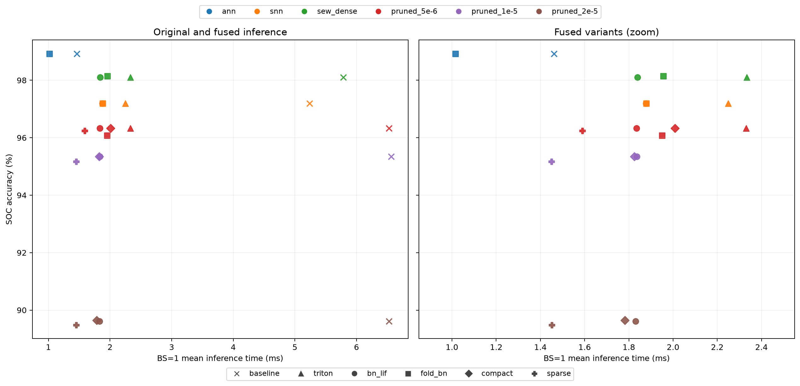

# Triton SNN 推理融合

实现：[inference.py](inference.py)；全量评估与计时：[benchmark_inference.py](benchmark_inference.py)。使用已有权重，不重新训练。T=4、FP32、初始膜电位为 0，适用于每张静态图独立推理。

## 与 spformers 的关系

参考 [spformers Triton LIF](https://github.com/putshua/spformers/blob/f5bfa1d9fd6e13c61802929c175397f57746ca39/spformers/neurons/_triton/triton_lif.py) 的时间循环展开，在一次 kernel 中完成 T 步膜电位更新。当前 checkpoint 使用 `v += (x-v)/tau`、`tau=2`、`v>=1` 发放、发放后清零；原库使用 `mem=mem*tau+x` 和 `mem>threshold`，不能直接替换。这里按 SpikingJelly 语义适配，并避免每次从 GPU 阈值 Tensor 调用 `.item()`。

[原 LIF＋GEMM kernel](https://github.com/putshua/spformers/blob/f5bfa1d9fd6e13c61802929c175397f57746ca39/spformers/ops/_triton/fused_lif_gemm_inference.py) 是 LIF 后接矩阵乘，不能直接代替 ResNet 的 3×3 Conv→BN→LIF。本实现为 CNN 增加了活跃坐标卷积和残差融合。

当前 SpikingJelly 0.0.0.0.14 的 LIF `eval()` 使用 TorchScript 逐时间步执行，即使训练配置是 CuPy；Triton 推理图替换这一路径。

## 融合方式

| mode | 运算 |
| --- | --- |
| `triton` | 将 4 步 LIF、二值 mask 和残差加法合成一个 kernel，BN 保持原实现 |
| `bn_lif` | 额外把冻结 BN 的 `a*z+b` 合入 LIF kernel，卷积权重不折叠 |
| `fold_bn` | 把 BN 系数折入卷积权重和 bias，再运行 Triton LIF |
| `compact` | `bn_lif` 加上全零中间通道移除、零输入分支常量化 |
| `sparse` | `compact` 加上 BS=1 活跃输出坐标 Conv＋BN＋LIF；更大 batch 回退到 compact 图 |

冻结 BN 系数为 `a=gamma/sqrt(var+eps)`、`b=beta-a*mean`。`bn_lif` 在神经元充电前应用仿射；`fold_bn` 改写卷积权重，有限精度累加顺序随之变化。例如 `5e-6` 的权重折叠版从 96.3299% 变为 96.0825%，所以单独保留该消融。

## mask 能吸收多少

二值 mask 在加载时冻结，推理时不用反复比较掩码、执行 `where` 或逐时间步相乘。Triton 在输出时应用 mask，并把 SEW 的残差加到输出；post-add SNN 则在膜电位更新前加残差。

空间 mask 不能普遍折成共享卷积权重。能够结构化删除的是中间层整条输出通道都为零的部分：同步裁掉该层输出通道和下一层输入通道，保留残差坐标。`1e-5` / `2e-5` 的最后一个残差块中间层完全关闭；考虑后一层 BN 的非零偏置后，将整段主分支预计算为常量。

对于其余空间稀疏性，`sparse` 在固定活跃坐标上直接计算卷积，只写需要的神经元输出；BN、T 步 LIF、mask 和 SEW 残差融合到该路径。输出仍保留残差所需的完整坐标形状。

| 剪枝权重 | 原始网络参数（不含 mask） | compact/sparse 推理图参数元素 | 推理图 Tensor MiB（含 buffer，sparse） |
| --- | ---: | ---: | ---: |
| SEW λ=5e-6 | 11,221,540 | 4,634,596 | 18.509 |
| SEW λ=1e-5 | 11,221,540 | 2,982,628 | 12.255 |
| SEW λ=2e-5 | 11,221,540 | 1,793,188 | 7.655 |

这是转换后推理图的实际裁剪结果，与原始训练参数统计分别记录。原始三个 λ 的网络参数相同、额外掩码均为 811,008 个；转换后的中间通道和常量分支不同，因此推理图参数量可以不同。

## 实测结果

完整 SOC 测试集 2425 张，分类与计时均为 BS=1；不进行微调。计时使用单张 L20Z、单 CPU 线程、CPU 核 37，预热 100 次、256 张固定分层图片、5 轮重复，并对每张图片打乱模型顺序。计入完整 T=4 前向、时间读出和状态重置，不含 IO/预处理/H2D。

| 模型 | 原始 Accuracy | bn_lif Accuracy | 原始 ms | bn_lif ms | sparse Accuracy | sparse ms |
| --- | ---: | ---: | ---: | ---: | ---: | ---: |
| post-add SNN | 97.1959% | 97.1959% | 5.2370 | 1.8781 | — | — |
| SEW-ResNet-18 | 98.1031% | 98.1031% | 5.7879 | 1.8394 | — | — |
| SEW λ=5e-6 | 96.3299% | 96.3299% | 6.5276 | 1.8352 | 96.2474% | 1.5899 |
| SEW λ=1e-5 | 95.3402% | 95.3402% | 6.5606 | 1.8363 | 95.1753% | 1.4501 |
| SEW λ=2e-5 | 89.6082% | 89.6082% | 6.5294 | 1.8298 | 89.4845% | 1.4521 |

三组 sparse 相对原始基线分别少分对 2 / 4 / 3 张测试图。稀疏点积与 cuDNN 的累加顺序不同，阈值会放大微小舍入差异，不能声称逐位等价。单独裁通道也不保证更快：`5e-6` 的 compact 为 2.0089 ms，bn_lif 为 1.8352 ms。

旧结果的分类 batch 为 64；本轮统一为 1。不同 batch 的卷积累加可以导致 SNN 阈值翻转，因此使用本轮原始图作为精度基线。

[完整指标 JSON](results/inference/metrics.json) / [汇总 CSV](results/inference/summary.csv) / [逐类 CSV](results/inference/per_class.csv)。JSON 包含全部分类指标、混淆矩阵、运行图存储统计、CUDA Event 时间、均值/P50/P95 和每轮均值。



## 使用

依赖沿用 `requirements-analysis.txt` 与 `pruning/requirements.txt`；本机 Triton 为 3.5.0（PyTorch 2.9.0 对应版本）。先按原结构加载 checkpoint，再转换：

```python
import torch
from benchmark import load_model
from inference import optimize

model, metadata, sew, config = load_model("/path/to/checkpoint.pt")
fast = optimize(model, sew=sew, mode="bn_lif")
with torch.inference_mode():
    logits = fast(normalized_images.cuda().float())
```

```bash
CUDA_VISIBLE_DEVICES=0 python benchmark_inference.py \
  --data /path/to/soc/test \
  --uploaded-dir /path/to/uploaded_checkpoints \
  --cpu-core 37
```

`sparse` 的输入固定为空间 mask 所对应的 128×128 图像，快速路径为 BS=1；不支持训练或跨样本保留膜电位。原始 checkpoint 保持不变，不提交新 checkpoint。
