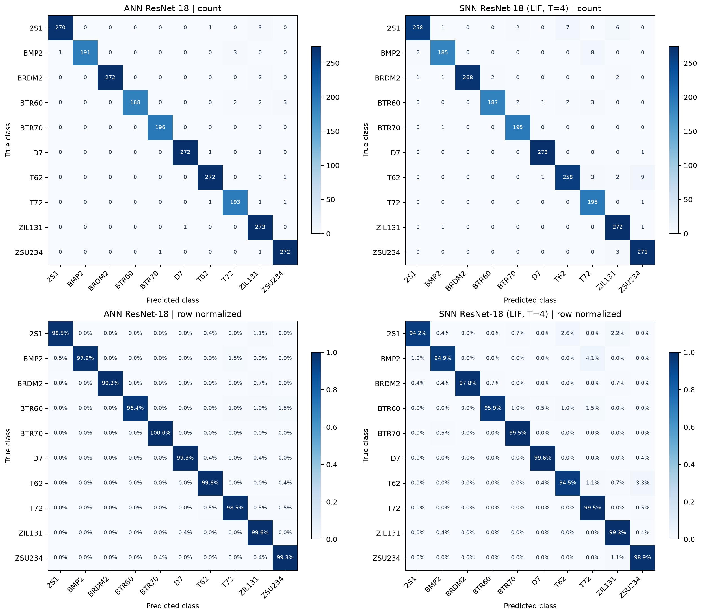
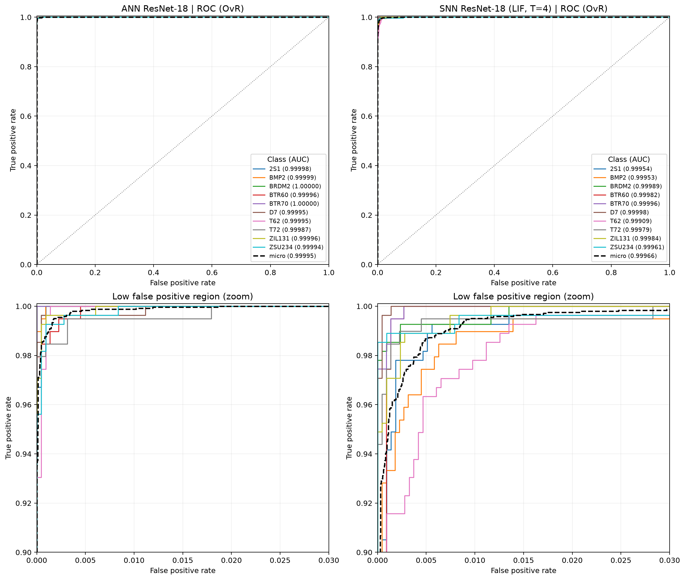
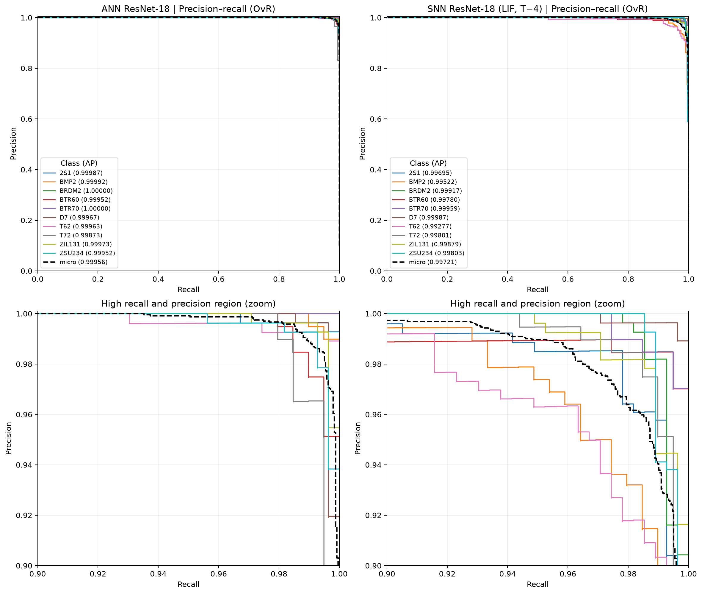

## 完整测试指标

使用已发布的第 100 epoch 权重，重新推理全部 **2425 张 SOC 测试图片**。灰度、128×128 中心裁剪、训练集均值/标准差与原实验一致；无测试增强，不重新训练或选择权重。两组预测的混淆矩阵均与原实验逐项一致。

本次评估通过 keeper 在单张 **NVIDIA L20Z** 上运行；节点和软件版本记录于 [metrics.json](metrics.json)。

| 指标 | ANN ResNet-18 | SNN ResNet-18，LIF T=4 |
| --- | ---: | ---: |
| Accuracy ↑ | 98.9278% | 97.4021% |
| Top-3 accuracy ↑ | 99.9588% | 99.8351% |
| Balanced accuracy / Macro recall ↑ | 98.8447% | 97.4035% |
| Macro precision ↑ | 98.9802% | 97.4068% |
| Macro F1 ↑ | 98.9044% | 97.3755% |
| Weighted F1 ↑ | 98.9292% | 97.3998% |
| ROC-AUC macro (OvR) ↑ | 0.999961 | 0.999705 |
| ROC-AUC micro (OvR) ↑ | 0.999949 | 0.999657 |
| mAP / Macro AP (OvR) ↑ | 0.999658 | 0.997619 |
| Micro AP (OvR) ↑ | 0.999558 | 0.997212 |
| Cohen's κ ↑ | 0.988052 | 0.971055 |
| MCC ↑ | 0.988069 | 0.971119 |
| Log loss ↓ | 0.029047 | 0.074486 |
| Multiclass Brier score ↓ | 0.014980 | 0.038894 |
| ECE (15 bins) ↓ | 0.3479% | 0.9198% |
| 错误数 | 26 / 2425 | 63 / 2425 |

### 指标口径

- 每张图片的十类分数为 FP32 推理 logits 的 float64 softmax。SNN 先对 4 个时间步的 logits 求均值，再做 softmax；每个 batch 重置膜电位。
- ROC 与 PR 使用 **one-vs-rest (OvR)**：每类分别作为正类，其余九类作为负类，遍历连续分数阈值。macro AUC 为十个类别 AUC 的算术平均；micro 将 2425×10 个标签/分数展开计算。
- **mAP 是图像分类的 macro AP**：按 [`average_precision_score`](https://scikit-learn.org/stable/modules/generated/sklearn.metrics.average_precision_score.html) 计算各类 AP，再等权平均。AP = Σₙ (Rₙ − Rₙ₋₁) Pₙ，使用召回增量加权，未采用梯形积分。此处不涉及目标检测的 IoU、mAP@0.5 或 mAP@0.5:0.95。
- Macro 对十类等权；Weighted F1 按各类测试样本数加权。单标签十分类中 micro precision、micro recall、micro F1 均等于 accuracy。
- Specificity = TN/(TN+FP)，按 OvR 定义；κ 与 MCC 衡量离散预测的一致性。Log loss 使用自然对数。Brier = meanᵢ Σ꜀ (pᵢ꜀−yᵢ꜀)²，范围 [0, 2]，不除以类别数或 2。
- ECE 使用 top-1 置信度的 15 个等宽分箱，对各箱 |准确率−平均置信度| 按样本比例加权。所有概率均未做温度缩放或测试集校准。
- 本表来自单次 seed=0 实验，未估计多次训练的方差。

### 混淆矩阵

纵轴为真实类别，横轴为预测类别；上排为计数，下排按真实类别归一化，每行和为 1。



### ROC 曲线

每种模型给出十类 OvR ROC 与 micro ROC；下排放大 FPR ≤ 0.03、TPR ≥ 0.90 区域。图例括号内为 AUC。



### Precision–Recall 曲线

图例括号内为 AP；mAP 是十类 AP 的平均值。下排放大 Recall ≥ 0.90、Precision ≥ 0.90 区域。



### 各类别指标

Precision、Recall、F1、Specificity 均以百分比展示；AUC 和 AP 范围为 [0, 1]。

#### ANN ResNet-18

| 类别 | 测试数 | Precision | Recall | F1 | Specificity | ROC-AUC | AP |
| --- | ---: | ---: | ---: | ---: | ---: | ---: | ---: |
| 2S1 | 274 | 99.6310% | 98.5401% | 99.0826% | 99.9535% | 0.999983 | 0.999866 |
| BMP2 | 195 | 100.0000% | 97.9487% | 98.9637% | 100.0000% | 0.999993 | 0.999922 |
| BRDM2 | 274 | 100.0000% | 99.2701% | 99.6337% | 100.0000% | 1.000000 | 1.000000 |
| BTR60 | 195 | 100.0000% | 96.4103% | 98.1723% | 100.0000% | 0.999956 | 0.999516 |
| BTR70 | 196 | 99.4924% | 100.0000% | 99.7455% | 99.9551% | 1.000000 | 1.000000 |
| D7 | 274 | 99.6337% | 99.2701% | 99.4516% | 99.9535% | 0.999954 | 0.999666 |
| T62 | 273 | 98.9091% | 99.6337% | 99.2701% | 99.8606% | 0.999954 | 0.999630 |
| T72 | 196 | 97.4747% | 98.4694% | 97.9695% | 99.7757% | 0.999872 | 0.998728 |
| ZIL131 | 274 | 96.4664% | 99.6350% | 98.0251% | 99.5351% | 0.999964 | 0.999727 |
| ZSU234 | 274 | 98.1949% | 99.2701% | 98.7296% | 99.7675% | 0.999937 | 0.999521 |

主要混淆（真实 → 预测）：2S1 → ZIL131：3 张；BMP2 → T72：3 张；BTR60 → ZSU234：3 张；BRDM2 → ZIL131：2 张；BTR60 → T72：2 张。

#### SNN ResNet-18 (LIF, T=4)

| 类别 | 测试数 | Precision | Recall | F1 | Specificity | ROC-AUC | AP |
| --- | ---: | ---: | ---: | ---: | ---: | ---: | ---: |
| 2S1 | 274 | 98.8506% | 94.1606% | 96.4486% | 99.8605% | 0.999544 | 0.996946 |
| BMP2 | 195 | 97.8836% | 94.8718% | 96.3542% | 99.8206% | 0.999526 | 0.995221 |
| BRDM2 | 274 | 100.0000% | 97.8102% | 98.8930% | 100.0000% | 0.999886 | 0.999172 |
| BTR60 | 195 | 98.9418% | 95.8974% | 97.3958% | 99.9103% | 0.999823 | 0.997796 |
| BTR70 | 196 | 97.9899% | 99.4898% | 98.7342% | 99.8205% | 0.999963 | 0.999589 |
| D7 | 274 | 99.2727% | 99.6350% | 99.4536% | 99.9070% | 0.999983 | 0.999866 |
| T62 | 273 | 96.6292% | 94.5055% | 95.5556% | 99.5818% | 0.999086 | 0.992767 |
| T72 | 196 | 93.3014% | 99.4898% | 96.2963% | 99.3719% | 0.999789 | 0.998011 |
| ZIL131 | 274 | 95.4386% | 99.2701% | 97.3166% | 99.3956% | 0.999841 | 0.998793 |
| ZSU234 | 274 | 95.7597% | 98.9051% | 97.3070% | 99.4421% | 0.999613 | 0.998034 |

主要混淆（真实 → 预测）：T62 → ZSU234：9 张；BMP2 → T72：8 张；2S1 → T62：7 张；2S1 → ZIL131：6 张；BTR60 → T72：3 张。

ANN 的 accuracy 比 SNN 高 **1.5258 个百分点**，少错 37 张。ROC-AUC、AP 衡量类别分数的排序能力，argmax 后的准确率和 F1 衡量最终分类结果，需结合阅读。

### 数据与复现

- [完整指标与溯源信息](metrics.json)；[逐类别 CSV](per_class.csv)。
- 原始预测分数：[ANN](ann_scores.npz)、[SNN](snn_scores.npz)。包含相对图片路径、真实标签、类别顺序、logits、softmax 概率和权重 SHA-256；使用 `numpy.load(..., allow_pickle=False)` 读取。
- 矢量图：[混淆矩阵](confusion_matrices.svg)、[ROC](roc_curves.svg)、[PR](precision_recall_curves.svg)。

```bash
pip install -r requirements-analysis.txt
python analyze.py --data /path/to/soc/test --device auto

# 直接使用已发布的分数重新生成指标和图表，无需推理
python analyze.py --reuse-scores
```
